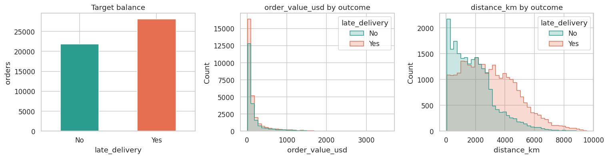
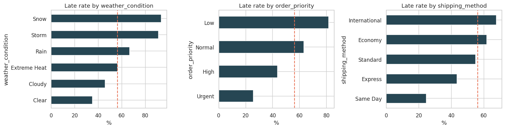
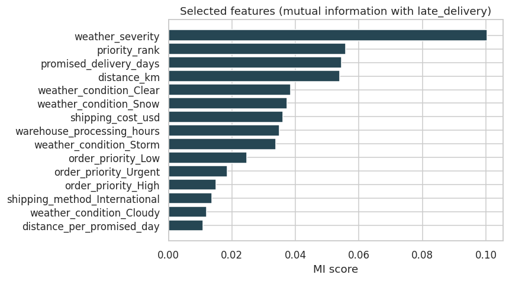
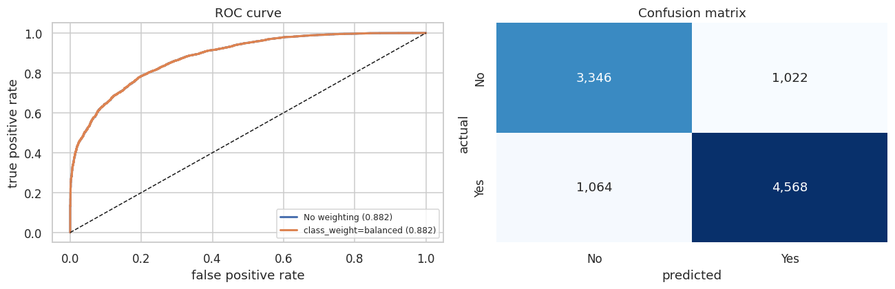
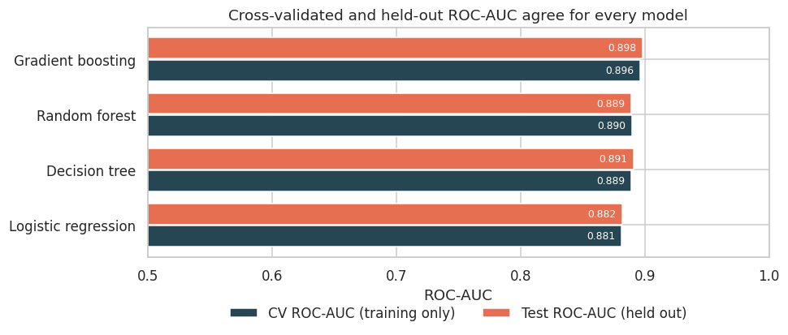
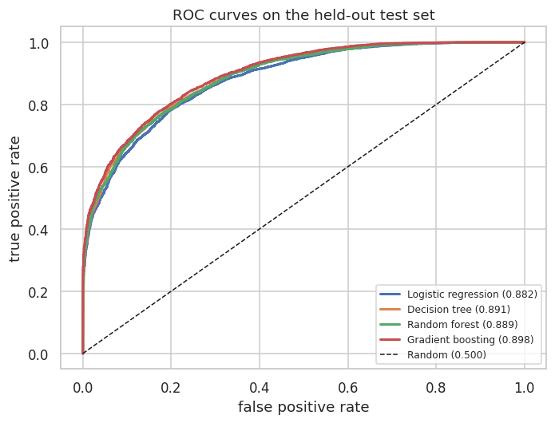
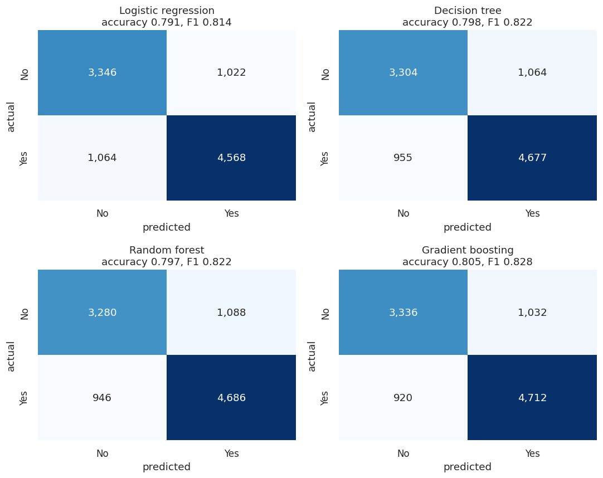
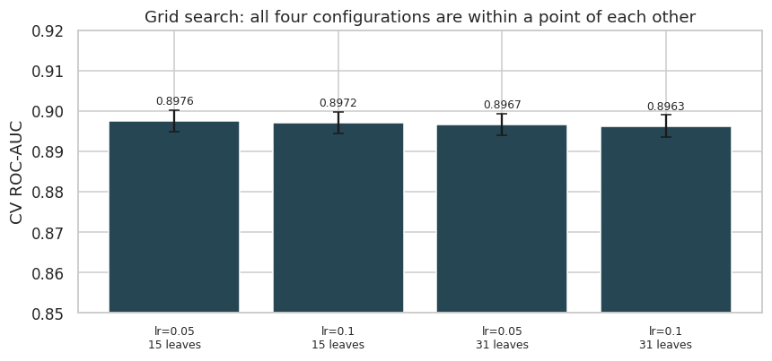
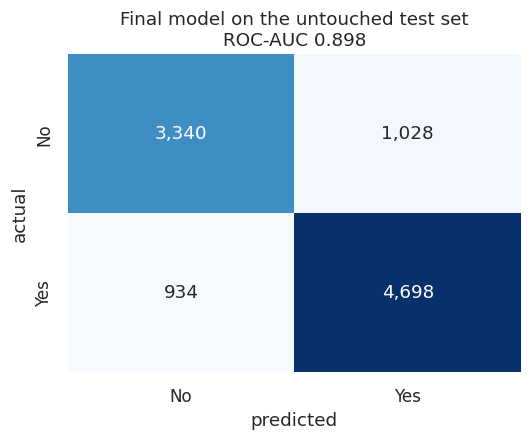

# 1. Introduction

## 1.1 Project title and overview

**Late Delivery Risk Prediction in E-Commerce Logistics.** The project predicts, at the moment an
order is accepted, whether that order will miss its promised delivery date. It uses the
*E-Commerce Delivery & Shipping Data 2026* dataset (50,000 orders, 30 columns) and is delivered as a
single Jupyter notebook (`CT24084.ipynb`) plus the raw and cleaned CSV files.

## 1.2 Problem statement

Every online order carries a promise — a number of days within which it should arrive. When the
actual delivery time exceeds that promise, the customer is disappointed, support costs rise and the
return rate increases. A fulfilment team cannot inspect 50,000 orders by hand, but it can act on a
ranked risk list: upgrade the service level, switch carrier, or notify the customer before the
promise is broken.

The question this project answers is therefore: **given only information that exists before the
parcel leaves the warehouse, can we predict whether an order will be delivered late?**

## 1.3 Objectives and expected outcome

1. Understand the dataset: its features, its target, and the relationships between them.
2. Diagnose and repair data-quality problems, and document every decision.
3. Build a leak-free preprocessing pipeline that is fitted on training data only.
4. Train and compare several classification models using cross-validation.
5. Tune the most promising model and evaluate it once on untouched test data.

**Expected outcome:** a model that separates late from on-time orders clearly better than the
majority-class baseline, with a reported ROC-AUC around 0.90, and a documented explanation of which
features drive the prediction.

## 1.4 Why machine learning is suitable

The outcome is not the product of one variable. Weather, order priority, distance, the promised
service level and warehouse processing time all contribute, and — as Section 3 shows — they
*interact*: a storm is far worse on a 6,000 km route than on a 500 km one. A hand-written rule would
need a branch for every combination of these conditions and would still miss combinations unseen in
the historical data.

There are 40,000 training orders, enough to estimate that structure, and the target is binary, so this
is a standard supervised classification problem with a clear, measurable answer. Finally, the output
is a probability per order, which is directly actionable: the team can rank orders and act on the
top decile rather than on a single yes/no cut.

# 2. Dataset Description

## 2.1 Source

| Item | Detail |
|---|---|
| Dataset | E-Commerce Delivery & Shipping Data 2026 |
| Source | Kaggle — `datascikhan/e-commerce-delivery-and-shipping-data-2026` |
| Link | https://www.kaggle.com/datasets/datascikhan/e-commerce-delivery-and-shipping-data-2026 |
| Licence | CC0 (public domain) |
| Size | 50,000 rows × 30 columns |
| Unit of observation | one order |

## 2.2 Features and target

The 30 columns fall into four groups. The role of each column was decided before any modelling, and
Section 4 explains the reasons.

::: {.featlist}
**Features (17)** — every one of these exists at order time, so all are legal model inputs:
`order_date`, `customer_segment`, `customer_country`, `warehouse_city`, `product_category`,
`product_weight_kg`, `order_value_usd`, `shipping_method`, `carrier`, `distance_km`,
`promised_delivery_days`, `shipping_cost_usd`, `package_size`, `payment_method`, `order_priority`,
`weather_condition` and `warehouse_processing_hours`.
:::

| Group | Columns | Use |
|---|---|---|
| **Target (1)** | `late_delivery` (Yes / No) | what is predicted |
| **Identifiers (4)** | `order_id`, `customer_id`, `customer_city`, `warehouse_id` | dropped — arbitrary codes or duplicates of another column |
| **Post-outcome leakage (8)** | `actual_delivery_days`, `delivery_delay_days`, `delivery_status`, `tracking_status`, `customer_rating`, `return_requested`, `return_reason`, `delivery_attempts` | dropped — recorded only after dispatch |

Cleaning adds one further input, `shipping_cost_capped`, a 0/1 flag for freight charges that were
censored at $500.

**Target distribution.** `Yes` 28,162 (56.32%) and `No` 21,838 (43.68%). The classes are close to
balanced, so accuracy is a meaningful metric and aggressive resampling is unnecessary.

## 2.3 Type of problem

**Binary classification.** `late_delivery` is categorical, so regression metrics (MAE, MSE, RMSE, R²)
do not apply; accuracy, precision, recall, F1, ROC-AUC and the confusion matrix are used instead. The
notebook states this explicitly rather than silently omitting the regression metrics.

# 3. Data Exploration and Understanding

## 3.1 Summary statistics

| Feature | Min | 25% | Median | 75% | Max | Mean |
|---|---|---|---|---|---|---|
| `product_weight_kg` | 0.10 | 0.32 | 0.93 | 2.61 | 52.19 | 2.26 |
| `order_value_usd` | 10.00 | 28.72 | 76.84 | 173.16 | 3,530.73 | 177.92 |
| `distance_km` | 40.0 | 1,086.8 | 2,182.8 | 3,592.5 | 9,553.6 | 2,496.8 |
| `promised_delivery_days` | 0 | 4 | 6 | 11 | 15 | 7.20 |
| `shipping_cost_usd` | 4.05 | 40.64 | 82.97 | 167.42 | 500.00 | 120.52 |
| `warehouse_processing_hours` | 1.00 | 6.60 | 11.90 | 20.70 | 48.00 | 14.41 |

Three columns are heavily right-skewed: weight (skew 4.00) and order value (3.52) have long upper
tails, and shipping cost (1.49) is capped at $500. This matters later for scaling and imputation.

## 3.2 Visual exploration

{width=100%}

{width=100%}

{width=72%}

## 3.3 Relationships between features and target

The rank ordering of association strength is consistent across three different measures (Cramér's V
for categories, point-biserial correlation for numbers, and mutual information in Section 4):

| Rank | Feature | Measure | Value |
|---|---|---|---|
| 1 | `weather_condition` | Cramér's V | 0.422 |
| 2 | `order_priority` | Cramér's V | 0.324 |
| 3 | `distance_km` | point-biserial r | +0.304 |
| 4 | `promised_delivery_days` | r | +0.264 |
| 5 | `warehouse_processing_hours` | r | +0.249 |
| 6 | `shipping_cost_usd` | r | +0.247 |
| 7 | `shipping_method` | Cramér's V | 0.216 |
| 8 | `carrier` | Cramér's V | 0.115 |
| — | `product_weight_kg` | r | +0.002 |
| — | `order_value_usd` | r | −0.001 |

**Weather.** Snow 93.5% late, Storm 91.0%, Rain 66.6%, Cloudy 45.9%, Clear 35.0%. A 58-point spread
between Snow (4,913 orders) and Clear (14,932 orders).

**Priority.** Low 81.7%, Normal 63.1%, High 43.7%, Urgent 25.7%. Urgent orders jump the warehouse
queue.

**Distance.** The late rate rises monotonically across bands: **38.5%** below 1,000 km, **49.2%** at
1,000–2,500 km, **68.0%** at 2,500–5,000 km and **82.8%** above 5,000 km.

**Money is not risk.** Order value is flat at 55.9–56.6% across all five quintiles, with r = −0.001.
Expensive orders are not late orders.

## 3.4 Key findings from exploration

1. Weather and priority dominate; distance is the backbone numeric feature.
2. The two strongest effects **compound**. Storm at 5,000+ km is **100% late (493 of 493)**; Clear
   below 1,000 km is **16.7%**. A main-effects-only model would average over exactly the cells that
   matter most.
3. Four categorical columns are statistically null: `product_category` (p = 0.970),
   `customer_segment` (p = 0.632), `package_size` (p = 0.341) and `payment_method` (p = 0.216).
4. There is **no seasonality in the target**: the monthly late rate varies only between 55.5% and
   57.7%, and the weather mix does not follow the calendar either — about 10% of July orders are
   snow-affected. Month therefore adds nothing to the model.
5. The target is **perfectly reconstructible** from post-delivery columns: `late_delivery` equals
   `actual_delivery_days > promised_delivery_days` on 50,000 of 50,000 rows.

# 4. Data Quality and Preprocessing

## 4.1 Identified issues and actions

| Issue | Evidence | Action |
|---|---|---|
| Missing values | Only `return_reason`, 41,375 rows (82.75%). The cross-tab with `return_requested` is perfectly diagonal: a reason exists if and only if a return happened. | Structural, not a defect. Column dropped as post-outcome. |
| Duplicate rows | 0 exact duplicates, 0 duplicates ignoring `order_id`, 0 repeated IDs. | Nothing removed. |
| Incorrect dtype | `order_date` stored as text; strict `%Y-%m-%d` parse succeeds for all rows. | Converted to `datetime64`. |
| Text inconsistency | 0 case or whitespace variants across all text columns. | Checked, no repair needed. |
| Future dates | 7,121 orders (14.2%) dated after the point the data was downloaded; the file covers the whole of 2026. | Kept and documented; date not used as a raw feature. |
| Status/outcome conflict | 5,816 rows marked In Transit / Delayed / Failed Delivery yet carrying a final outcome. | Kept; `delivery_status` dropped as leakage. |
| Censored value | `shipping_cost_usd` = 500 exactly 658 times, against 11 for the next most common value. All are long-haul (≥ 3,525 km) and 81.3% are late. | Kept, with an explicit `shipping_cost_capped` flag. |
| Outliers | IQR flags 5,926 order values (11.85%) holding **55.68% of total revenue**. Their late rate is 56.33%, against 56.32% elsewhere. | Kept — they are real orders, not errors. |
| Target leakage | Eight post-dispatch columns; `delivery_delay_days` alone gives ROC-AUC **1.0000**; one-star ratings are 962 of 962 late orders. | All eight removed from the feature set. |
| Redundant columns | `customer_city` (99 levels) maps many-to-one to country; `warehouse_id` is 1:1 with `warehouse_city`. | Both dropped, one representative kept. |

## 4.2 Cleaning decisions and their reasoning

The cleaned file is 50,000 × 19 with **zero missing values**. Three decisions deserve explanation:

- **Outliers were not removed.** The standard 1.5 × IQR rule would delete 11.85% of rows carrying more
  than half of all revenue, while their late rate is identical to the rest. That is the textbook case
  where mechanical outlier removal destroys signal. Heavy tails are handled by scaling and by tree
  models instead.
- **The $500 cost ceiling was flagged, not erased.** Re-estimating censored prices would invent data;
  deleting them would remove the most informative long-haul orders. A binary flag lets the model treat
  capped shipments separately.
- **Future-dated and unfinished-status rows were kept.** Dropping them would delete 14.2% and 11.6% of
  the data respectively to fix columns that either do not enter the model (status) or are not raw
  features (date). Both choices are documented in the notebook.

## 4.3 Handling categorical and numerical features

**Numerical features** are median-imputed and standardised. The median is used because the numeric
features are right-skewed (Section 3.1), and the median is unaffected by the extreme tail that the mean
is dragged towards — for order value the mean is $177.92 against a median of $76.84. Standardisation
(z-scores) is required by logistic regression and harmless for trees; min–max scaling was rejected
because the maximum order value is 2.43× its 99th percentile, which would push 76.7% of orders into
the bottom 5% of the transformed range.

**Categorical features** are most-frequent-imputed and one-hot encoded. All of them are nominal — a
label encoding would invent a ranking such as "Snow > Rain". `handle_unknown="ignore"` guarantees that
a category unseen in training produces a zero row instead of an error at prediction time.

Both transforms live inside a scikit-learn `ColumnTransformer` inside a `Pipeline`, so they are
refitted from scratch on every cross-validation fold and on the final fit. No statistic from the
validation or test rows is ever used.

## 4.4 Feature engineering and selection

Three row-wise features were added, each tied to a finding from Section 3:

| Feature | Definition | Rationale |
|---|---|---|
| `weather_severity` | Clear 0 → Snow 5 | Turns six unordered levels into the observed risk gradient |
| `priority_rank` | Urgent 0 → Low 3 | Same, for the priority queue |
| `distance_per_promised_day` | km ÷ max(promise, 1) | How much ground each promised day must cover |

`order_date` was dropped rather than decomposed into month and weekday, because the exploration showed
no seasonal pattern to capture.

Selection uses `SelectKBest` with **mutual information**, fitted on training data only, keeping 15
encoded columns. Mutual information is preferred to a correlation filter because it captures
non-linear dependence — the multiplicative weather × distance relationship is exactly the case where
Pearson correlation understates a feature's value.

{width=82%}

## 4.5 Important preprocessing decisions, summarised

| Decision | Why |
|---|---|
| Split before any transformation | Otherwise the scaler, imputer and selector see test rows |
| Imputation inside the pipeline | Guarantees train-only statistics in every fold |
| Median rather than mean imputation | Skewed distributions; the median ignores the extreme tail |
| One-hot rather than ordinal encoding | Nominal categories without inherent order |
| StandardScaler rather than MinMaxScaler | Extreme order values would compress the useful range |
| Mutual-information selection, k = 15 | Removes redundant dummies while keeping the strong non-linear signals |
| No resampling | 56.3/43.7 is a mild imbalance (1.3:1); class weighting was tested and did not improve ranking |

{width=100%}

# 5. Machine Learning Methodology

## 5.1 Train–test split

| Item | Value |
|---|---|
| Method | `train_test_split` |
| Test size | 20% (10,000 orders) |
| Stratification | `stratify=y` — both halves keep the 56.3% late rate |
| Random seed | `random_state=42` |
| Training rows | 40,000 (late rate 56.33%) |
| Test rows | 10,000 (late rate 56.32%) |

The split happens **before** imputation, scaling, encoding or selection. This is the single most
important line of defence against leakage: if a scaler is fitted on all 50,000 rows, the training set
has already seen the test set's means and variances.

A stratified random split is appropriate because this is not a time series. Orders are independent
events, and the late rate is flat across all twelve months, so a temporal split would not create a
meaningfully different test set. The test set is used exactly once, at the end.

## 5.2 Algorithms

| Model | How it works | Key settings |
|---|---|---|
| **Logistic regression** | Computes a weighted sum of the inputs and maps it to a probability with the logistic function; the decision boundary is linear in the input features. Fitted by maximising the likelihood. | `max_iter=1000` |
| **Decision tree** | Recursively splits the training data at the threshold that most reduces impurity (Gini), producing a set of if/else rules. | `max_depth=8`, `min_samples_leaf=20` |
| **Random forest** | Fits many trees on bootstrap samples of the rows, each considering a random subset of features at every split, then averages their predicted probabilities. | 200 trees, `min_samples_leaf=5` |
| **Gradient boosting** | Fits trees sequentially, each trained on the residual error of the current ensemble, with a learning rate controlling each tree's contribution. | 200 iterations, `learning_rate=0.1` |

All four are wrapped in the identical preprocessing pipeline, so the comparison isolates the model
and nothing else.

## 5.3 Cross-validation

Five-fold **stratified** cross-validation on the 40,000 training rows only
(`StratifiedKFold(n_splits=5, shuffle=True, random_state=42)`). Stratification preserves the class
ratio in every fold; shuffling prevents the folds from following the original row order. Every metric
in the comparison table is the mean of five fold scores, and the fold-to-fold standard deviation is
reported so that differences can be judged against noise.

## 5.4 Hyperparameter tuning

`GridSearchCV` on the gradient-boosting pipeline, scoring ROC-AUC, using the same five folds:

| Parameter | Values searched | What it controls |
|---|---|---|
| `learning_rate` | 0.05, 0.10 | How much each new tree contributes |
| `max_leaf_nodes` | 15, 31 | How complex each tree may be |

Four configurations × five folds = 20 pipeline fits, each refitting imputation, encoding and feature
selection from scratch. The search never sees the test data.

## 5.5 How leakage is prevented, step by step

| Stage | Data it may use |
|---|---|
| Imputation, scaling, encoding, selection | fitted inside the pipeline → training rows of the current fold only |
| Cross-validation | training rows only |
| Grid search | training rows only, through the same folds |
| Model selection | CV score on training rows only |
| Test evaluation | once, after every decision is fixed |

Because the selector is a pipeline step, a fold's validation rows cannot influence which features are
kept. This closes the most common leak in feature-selection workflows.

# 6. Model Evaluation and Comparison

## 6.1 Metrics and why they are appropriate

- **Accuracy** — share of correct predictions. Meaningful here because the classes are close to
  balanced, but insufficient on its own: a model can be accurate while missing most late orders.
- **Precision** — of the orders flagged late, how many really are. High precision means few false
  alarms (unnecessary upgrades).
- **Recall** — of the orders that are actually late, how many were caught. High recall means few
  missed late deliveries.
- **F1** — harmonic mean of precision and recall, useful because the two trade off.
- **ROC-AUC** — probability that a randomly chosen late order is ranked above a randomly chosen
  on-time order. It measures ranking quality independently of the 0.5 threshold, which matters because
  the operating threshold is a business decision.
- **Confusion matrix** — the actual counts behind the four metrics above.

## 6.2 Cross-validated comparison

| Model | CV accuracy | CV precision | CV recall | CV F1 | CV ROC-AUC (std) |
|---|---|---|---|---|---|
| Logistic regression | 0.790 | 0.811 | 0.818 | 0.815 | 0.881 (0.003) |
| Decision tree | 0.798 | 0.809 | 0.838 | 0.824 | 0.889 (0.003) |
| Random forest | 0.798 | 0.811 | 0.836 | 0.823 | 0.890 (0.003) |
| Gradient boosting | **0.804** | **0.816** | **0.842** | **0.829** | **0.896** (0.003) |

## 6.3 Held-out test comparison

| Model | Test accuracy | Test precision | Test recall | Test F1 | Test ROC-AUC |
|---|---|---|---|---|---|
| Logistic regression | 0.791 | 0.817 | 0.811 | 0.814 | 0.882 |
| Decision tree | 0.798 | 0.815 | 0.830 | 0.822 | 0.891 |
| Random forest | 0.797 | 0.812 | 0.832 | 0.822 | 0.889 |
| Gradient boosting | **0.805** | **0.820** | **0.837** | **0.828** | **0.898** |

{width=85%}

{width=62%}

{width=88%}

## 6.4 Hyperparameter tuning: before and after

| Stage | Configuration | CV ROC-AUC | Test ROC-AUC | Test F1 |
|---|---|---|---|---|
| Before tuning | `max_iter=200, lr=0.10, leaves=31` | 0.896 | 0.898 | 0.828 |
| After tuning | `learning_rate=0.05, max_leaf_nodes=15, max_iter=200` | **0.898** | 0.898 | 0.827 |

{width=80%}

# 7. Results and Discussion

## 7.1 Best and worst models

**Gradient boosting is best on every metric** (CV ROC-AUC 0.896, test 0.898, test F1 0.828).
**Logistic regression is worst** (0.881 CV, 0.882 test).

The decision tree (0.889 CV / 0.891 test) and the random forest (0.890 CV / 0.889 test) sit between
them and are effectively tied — the sign of their 0.001 difference flips between CV and test, which is
what noise looks like at this sample size.

## 7.2 Why the models differ

- **The linear model is limited by its functional form.** Logistic regression sees
  `weather_severity` and `distance_km` as separate additive terms, so it must average over their
  interaction — the weakness Section 3.4 identified. Its training and CV scores are identical
  (0.881/0.881), which is the signature of high bias, not overfitting: it cannot represent the pattern,
  so it cannot memorise it either.
- **The tree ensembles can represent the interaction** without being told about it, because a split on
  distance can sit directly beneath a split on weather. That is worth 0.007–0.016 ROC-AUC over the
  linear model.
- **Boosting beats bagging here** because the dataset is dominated by a few high-risk cells. Boosting
  re-weights errors sequentially, so later trees concentrate on the storm/long-haul cases that earlier
  trees under-predicted. Bagging averages independently fitted trees and has no mechanism to focus.
- **The single tree is competitive** once regularised (`max_depth=8`, 20 orders per leaf). With
  40,000 rows, a depth-8 tree already captures the structure; the forest's variance reduction adds
  little because there is little variance left to remove.

## 7.3 Overfitting and underfitting

| Model | Train ROC-AUC | CV ROC-AUC | Test ROC-AUC | Train − CV gap |
|---|---|---|---|---|
| Logistic regression | 0.881 | 0.881 | 0.882 | −0.000 |
| Decision tree | 0.901 | 0.889 | 0.891 | 0.012 |
| Random forest | 0.961 | 0.890 | 0.889 | **0.071** |
| Gradient boosting | 0.906 | 0.896 | 0.898 | 0.010 |

- **The random forest shows the largest training gap** (0.961 vs 0.890). Its individual trees memorise
  their bootstrap samples, and the averaged training predictions stay optimistic. Its CV and test
  scores still agree (0.890 vs 0.889), so this is a training-score artefact rather than a
  generalisation failure.
- **The other three show small gaps** (0.012, 0.010, −0.000), so neither the depth limits nor the
  boosting rounds let them run away.
- **No model underfits**: every model beats the 0.563 majority-class baseline by a wide margin, and the
  fold-to-fold standard deviation is 0.003 for all four.
- The test score is within 0.002 of the CV score for every model, which confirms the cross-validation
  estimate was honest.

## 7.4 Did tuning improve performance?

Barely, and that is the honest answer. The best configuration (learning rate 0.05, 15 leaves) raised CV
ROC-AUC from 0.8964 to 0.8976 — **+0.0012**, less than half the fold-to-fold standard deviation. Test
ROC-AUC was unchanged at 0.898 and test F1 slipped from 0.828 to 0.827.

Two conclusions follow. First, the model is limited by its features, not its settings: the remaining
error comes from causes the dataset does not record (carrier execution, traffic, local disruptions).
Second, the search cost 20 extra pipeline fits for no measurable gain, which is worth reporting
alongside the result rather than hiding.

## 7.5 Final model on the untouched test set

The tuned gradient-boosting pipeline, fitted on all 40,000 training rows, was evaluated once on the
10,000 held-out orders:

| Metric | Value |
|---|---|
| Accuracy | 0.804 |
| ROC-AUC | **0.898** |
| F1 (late class) | 0.827 |
| Precision (late) | 0.820 |
| Recall (late) | 0.834 |
| Confusion matrix | TN 3,340 · FP 1,028 · FN 934 · TP 4,698 |

{width=50%}

In operational terms: of 10,000 orders, the model catches **4,698 of the 5,632 late ones (83.4%)**
while raising **1,028 false alarms**. Whether that balance is right depends on the relative cost of a
missed late delivery and an unnecessary upgrade — a question the dataset cannot answer.

## 7.6 Limitations and possible improvements

- **One year of orders.** Monthly late rates stay between 55.5% and 57.7%, so there is no seasonality
  to learn and no year-over-year drift to measure. The reported scores describe this 2026 sample; a
  later period could shift them.
- **The promise is partly circular.** `promised_delivery_days` correlates 0.93 with
  `actual_delivery_days`, so the model partly learns "long promise → late". That is operationally true
  but weaker as a causal story.
- **No cost matrix.** Precision and recall are reported separately rather than combined into a business
  loss, so the 0.5 threshold is a default rather than an optimum.
- **A single split.** One random 20% test sample gives one estimate; repeated nested CV would give
  tighter confidence intervals.
- **Four models, one tuned.** The comparison is wide, not exhaustive. A neural network or a
  properly-tuned random forest could be added, and probability calibration would make the outputs
  directly usable as risk scores.
- **Threshold optimisation** is the most promising operational improvement: lowering the 0.5 cut-off
  trades precision for recall monotonically and costs nothing to train.

# 8. Conclusion

The project set out to predict, at order time, whether an e-commerce order would miss its promised
delivery date, using only pre-dispatch information. It achieved that:

1. **The data was cleaned and documented.** 50,000 rows, zero duplicates, one structurally missing
   column, and eight post-outcome columns that had to be removed — `delivery_delay_days` alone
   reproduces the target perfectly (AUC 1.0000).
2. **The exploration found the real drivers.** Weather (Snow 93.5% late vs Clear 35.0%), priority (Low
   81.7% vs Urgent 25.7%) and distance (38.5% below 1,000 km vs 82.8% above 5,000 km), with weather and
   distance compounding — storm at 5,000+ km is 100% late.
3. **Four models were compared under identical, leak-free cross-validation.** Gradient boosting was
   best (CV ROC-AUC 0.896), logistic regression worst (0.881); the tree and forest tied in between.
4. **Tuning gave a negligible gain** (+0.0012 CV), showing the model is feature-limited rather than
   setting-limited.
5. **The final model achieved 0.898 ROC-AUC** on untouched test data — 0.804 accuracy and 0.828 F1,
   against a 0.563 majority-class baseline — with preprocessing refitted inside every fold, so no test
   information influenced any decision.

**Objectives achieved.** The model ranks orders by lateness risk well above the baseline and is honest
about its limits: it cannot explain delays caused by factors the dataset never records, and it should
be calibrated and threshold-tuned before operational use.

# 9. References

1. *E-Commerce Delivery & Shipping Data 2026*, Kaggle, CC0.
   https://www.kaggle.com/datasets/datascikhan/e-commerce-delivery-and-shipping-data-2026
2. Pedregosa, F. et al. (2011). Scikit-learn: Machine Learning in Python. *Journal of Machine Learning
   Research*, 12, 2825–2830.
3. McKinney, W. (2010). Data Structures for Statistical Computing in Python. *Proceedings of the 9th
   Python in Science Conference*, 56–61.
4. Hunter, J. D. (2007). Matplotlib: A 2D Graphics Environment. *Computing in Science & Engineering*,
   9(3), 90–95.
5. Waskom, M. (2021). Seaborn: Statistical Data Visualization. *Journal of Open Source Software*,
   6(60), 3021.
6. Breiman, L. (2001). Random Forests. *Machine Learning*, 45, 5–32.
7. Friedman, J. H. (2001). Greedy Function Approximation: A Gradient Boosting Machine. *Annals of
   Statistics*, 29(5), 1189–1232.
